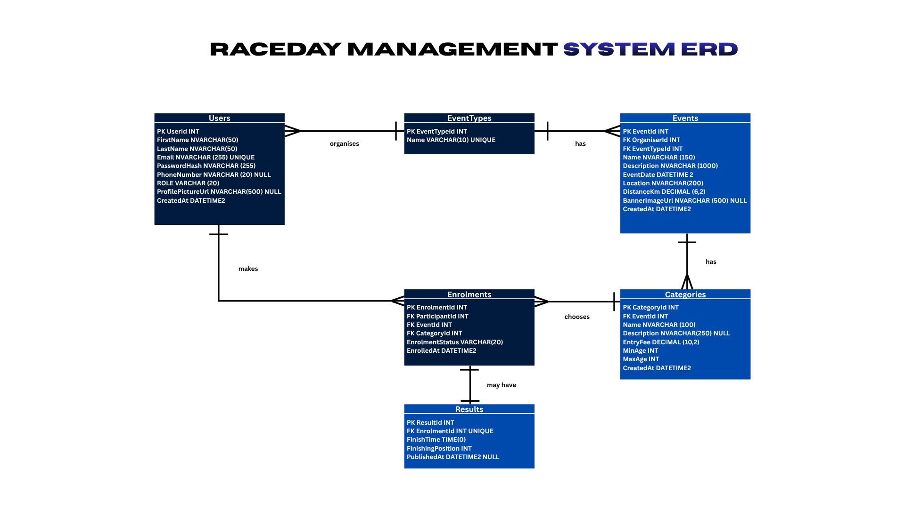
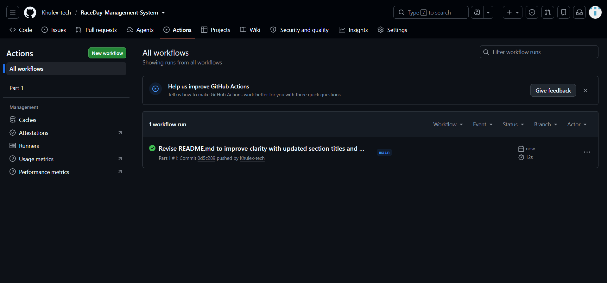
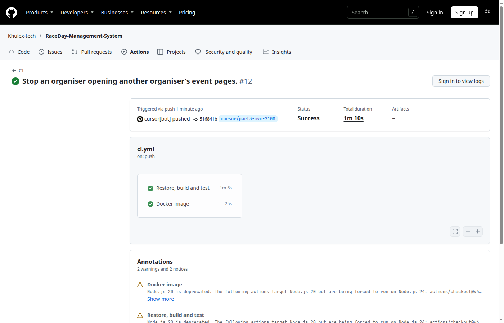

# RaceDay - Event Management System for South African Road Events

**Module:** PROG6212 - Programming 2B  
**Portfolio of Evidence - Parts 1, 2 and 3**  
**Repository:** RaceDay-Management-System

---

## 1. Project Overview

RaceDay is a web-based event management platform for South African road running, walking and cycling events.

Part 1 is the plan (ERD, endpoint table and SQL script). Part 2 is the ASP.NET Core Web API and its tests. Part 3 is the MVC site that calls that API, Azure Blob Storage for images, and Docker.

Part 2 delivers the full RESTful API built with ASP.NET Core Web API and Entity Framework Core, implementing all 40 endpoints planned in `docs/API_EndpointPlan.md`.

Key deliverables included in Part 2:
- **ASP.NET Core Web API (`RaceDay.API`)**: Complete C# Web API project with EF Core Code-First data context (`RaceDayDbContext`).
- **Authentication & Role Authorization**: Server-side session authentication (`ISession`) with secure PBKDF2 password hashing and strict Organiser vs Participant role enforcement.
- **Swagger / OpenAPI Integration**: Full Swagger UI integration with XML documentation comments and annotated HTTP response status codes.
- **Unit Testing Suite (`RaceDay.Tests`)**: Comprehensive xUnit test suite (41 unit tests) covering authentication, role rejection, trusted Organiser registration, event CRUD, category management, enrolment workflow, result processing, and API health.
- **Automated CI/CD**: GitHub Actions workflow (`.github/workflows/ci.yml`) automatically restoring, building, and executing unit tests on every push.

---


## 2. System Roles


| Role            | What the role can do                                                                                                                                                                                                                                                                                                                               |
| --------------- | -------------------------------------------------------------------------------------------------------------------------------------------------------------------------------------------------------------------------------------------------------------------------------------------------------------------------------------------------- |
| **Organiser**   | Register through the trusted invite-code endpoint and log in. Create, edit and delete their own events (name, description, date, location, distance, event type). Define categories per event (name, description, entry fee, age range). View enrolments for their events, confirm or cancel enrolments, and capture finish times and finishing positions. Upload an event banner (Part 3). |
| **Participant** | Register and log in. Browse and view events with categories. Enter an event by selecting a category. View and update their own enrolments (withdraw or change category before race day). View personal race history (finish time and finishing position). Update their profile and upload a profile picture (Part 3).                              |


Both roles are stored in one `Users` table using a `Role` column (`Organiser` or `Participant`). In Part 2 the session will store `UserId` and `Role`. Organisers may only manage events they created. Participants may only manage their own enrolments and results.

---


## 3. Repository Structure

```
.
├── .github/
│   └── workflows/
│       ├── ci.yml                    Build, unit tests, SQL Server, Azurite and Docker images
│       └── part1.yml                 Part 1 static check workflow
├── docs/
│   ├── RACEDAYERD.png                Section A — ERD (PNG)
│   ├── API_EndpointPlan.md           Section B — API endpoint plan (Markdown)
│   ├── RaceDay_DatabaseScript.sql    Section C — SQL Server schema + seed data
│   └── SUCCESSFUL-CI.png             Screenshot of a successful CI run
├── Dockerfile                        Part 3 MVC image
├── docker-compose.yml                SQL Server, Azurite, API and MVC
├── RaceDay.Web/                      ASP.NET Core MVC site (calls the API only)
├── RaceDay.Web.Tests/                MVC session and navigation tests
├── RaceDay.Integration/              SQL Server and Azurite flow test
├── RaceDay.API/                      ASP.NET Core Web API Project
│   ├── Controllers/                  API Controllers (Auth, Users, Events, Categories, Enrolments, Results, Support)
│   ├── Data/                         RaceDayDbContext & Data Seeder
│   ├── Dtos/                         Request/Response Data Transfer Objects
│   ├── Helpers/                      Password Hashing (PBKDF2), Image Uploads, & Role Constants
│   ├── Models/                       EF Core Entity Models
│   └── Program.cs                    Middleware, Session, and Swagger Configuration
├── RaceDay.Tests/                    API unit tests, including blob URL and race-prep checks
│   ├── Controllers/                  Unit tests for all controllers
│   └── TestHelpers/                  In-Memory DbContext factory & TestSession mock
├── RaceDay.sln                       Visual Studio Solution file
├── LICENSE
└── README.md
```


---


## 4. Section A — Entity Relationship Diagram (ERD)



### Brief requirements checklist


| Requirement                                                              | How this submission meets it                                                                                                           |
| ------------------------------------------------------------------------ | -------------------------------------------------------------------------------------------------------------------------------------- |
| Full RaceDay data model with a **minimum of six entities**               | **Six entities:** `Users`, `EventTypes`, `Events`, `Categories`, `Enrolments`, `Results`                                               |
| Show attributes, **primary keys**, **foreign keys**, and **cardinality** | Each entity lists attributes and types; PKs and FKs are labelled; crow's-foot notation shows one-to-many and the resolved many-to-many |
| Submit as **PNG or PDF** inside `/docs`                                  | Submitted as PNG: `docs/RACEDAYERD.png`                                                                                                |
| SQL script in Section C must **match the ERD exactly**                   | See Section C and the alignment note below — **no deliberate differences**                                                             |


### Entities


| Entity       | Purpose                                   | Key attributes                                                                                   |
| ------------ | ----------------------------------------- | ------------------------------------------------------------------------------------------------ |
| `Users`      | Organisers and Participants               | PK `UserId`; `Email` UNIQUE; `Role`; `PasswordHash`; optional `PhoneNumber`, `ProfilePictureUrl` |
| `EventTypes` | Run / Walk / Cycle                        | PK `EventTypeId`; `Name` UNIQUE                                                                  |
| `Events`     | Events owned by an Organiser              | PK `EventId`; FK `OrganiserId` → `Users`; FK `EventTypeId` → `EventTypes`                        |
| `Categories` | Entry options for an event                | PK `CategoryId`; FK `EventId` → `Events`; `EntryFee`, `MinAge`, `MaxAge`                         |
| `Enrolments` | Participant enters an event in a category | PK `EnrolmentId`; FKs `ParticipantId`, `EventId`, `CategoryId`; `EnrolmentStatus`                |
| `Results`    | Optional result for one enrolment         | PK `ResultId`; FK `EnrolmentId` UNIQUE → `Enrolments` (enforces 1:1)                             |


### Relationships and cardinality


| Relationship                        | Cardinality                         | Notes                                        |
| ----------------------------------- | ----------------------------------- | -------------------------------------------- |
| `Users` (as Organiser) → `Events`   | **One-to-many**                     | One Organiser organises many events          |
| `EventTypes` → `Events`             | **One-to-many**                     | One type has many events                     |
| `Events` → `Categories`             | **One-to-many**                     | One event has many categories                |
| `Users` (as Participant) ↔ `Events` | **Many-to-many** (via `Enrolments`) | Resolved by the `Enrolments` junction entity |
| `Categories` → `Enrolments`         | **One-to-many**                     | One category is chosen by many enrolments    |
| `Enrolments` → `Results`            | **One-to-one** (optional)           | An enrolment may have one result             |


**Design notes**

1. **Many-to-many via** `Enrolments`**:** Participants and events cannot be linked directly. `Enrolments` stores `CategoryId` and `EnrolmentStatus` as well as the two FKs.
2. `Results` **hangs off** `Enrolments`**:** A result cannot exist without an enrolment; `UNIQUE(EnrolmentId)` enforces at most one result per enrolment.

---


## 5. Section B — API Endpoint Plan

**Deliverable:** `[docs/API_EndpointPlan.md](docs/API_EndpointPlan.md)`

The endpoint plan was written before any Part 2 API code. It is the contract the ASP.NET Core Web API will follow later.

### Brief requirements checklist


| Requirement                                                                                                                  | How this submission meets it                                          |
| ---------------------------------------------------------------------------------------------------------------------------- | --------------------------------------------------------------------- |
| Table completed **before** Part 2 code                                                                                       | Plan is ready; no API project code is in this repo yet                |
| Columns: **HTTP Method, Route, Description, Role Required, Request Body, Expected Response**                                 | Every endpoint row in `API_EndpointPlan.md` uses those six columns    |
| Cover **Authentication** (register & login), **User Profile**, **Events**, **Categories**, **Event Enrolments**, **Results** | These areas are covered in the plan (plus a few supporting endpoints) |
| Submit as **PDF or Markdown** in `/docs`                                                                                     | Submitted as Markdown: `docs/API_EndpointPlan.md`                     |
| Part 2 API must closely match this plan                                                                                      | Part 2 will be built against this document                            |


### Resource groups planned


| Resource group   | Covered in plan | Examples from the plan                                           |
| ---------------- | --------------- | ---------------------------------------------------------------- |
| Authentication   | Yes             | `POST /api/auth/register`, `POST /api/auth/login`                |
| User Profile     | Yes             | `GET/PUT /api/users/profile`, password change, profile picture   |
| Events           | Yes             | List, detail, create, update, delete, banner upload, event types |
| Categories       | Yes             | Categories nested under events, plus category CRUD               |
| Event Enrolments | Yes             | Enter event, my enrolments, status/category updates, withdraw    |
| Results          | Yes             | Capture, update, delete, event results, my results               |


Role values in the plan are **None** (public), **Any** (logged in), **Organiser** or **Participant**. Routes start with `/api/`.

Full endpoint details are in `[docs/API_EndpointPlan.md](docs/API_EndpointPlan.md)`.

---


## 6. Section C — SQL Database Script

**Deliverable:** `[docs/RaceDay_DatabaseScript.sql](docs/RaceDay_DatabaseScript.sql)`

The script creates the RaceDay database in SQL Server Management Studio. It drops and recreates `RaceDayDb`, so it can be run again on a clean instance.

### Brief requirements checklist


| Requirement                                                                                                  | How this submission meets it                                                                   |
| ------------------------------------------------------------------------------------------------------------ | ---------------------------------------------------------------------------------------------- |
| `CREATE TABLE` for **every entity in the ERD**                                                               | Creates all six tables: `Users`, `EventTypes`, `Events`, `Categories`, `Enrolments`, `Results` |
| **Primary keys, foreign keys**, and constraints (`NOT NULL`, `UNIQUE`, `DEFAULT`)                            | Defined in the script (plus `CHECK` constraints where needed)                                  |
| Seed data: **≥ 2 Organisers**, **≥ 2 Participants**, **≥ 3 Events**, categories per event, sample enrolments | Seeded as shown below                                                                          |
| Saved as `.sql` in `/docs`                                                                                   | `docs/RaceDay_DatabaseScript.sql`                                                              |
| Runs without errors on a **clean SQL Server** instance                                                       | Script drops/recreates `RaceDayDb`, then creates schema and seeds data                         |


### Sample data in the script

These counts come from the `INSERT` statements in `RaceDay_DatabaseScript.sql`:


| Seed item    | Count | Detail                                                                                     |
| ------------ | ----- | ------------------------------------------------------------------------------------------ |
| Organisers   | 2     | Thabo Mokoena, Ayesha Patel                                                                |
| Participants | 4     | Sipho, Lerato, Johan, Nomvula                                                              |
| Events       | 3     | Soweto Marathon (Run), Cape Town Cycle Tour (Cycle), Durban Beachfront Charity Walk (Walk) |
| Categories   | 10    | Categories across all three events                                                         |
| Enrolments   | 8     | Includes Pending, Confirmed and Cancelled                                                  |
| Results      | 3     | Finish times and finishing positions for completed enrolments                              |


### How to run (SSMS)

1. Open `docs/RaceDay_DatabaseScript.sql` in SQL Server Management Studio.
2. Connect to a clean SQL Server instance.
3. Execute the full script (F5).
4. Check the `SELECT` statements at the end (row counts, enrolments, results).

Or from the command line:

```bash
sqlcmd -S "(localdb)\MSSQLLocalDB" -i "docs/RaceDay_DatabaseScript.sql"
```

---


## 7. ERD and SQL alignment (Section A ↔ Section C)

The brief says the SQL script must match the ERD exactly, and any deliberate differences must be explained here.

**There are no deliberate differences.** `RaceDay_DatabaseScript.sql` matches `docs/RACEDAYERD.png` for:

- the same six entities;
- the same attributes and data types used in the diagram;
- the same primary keys and foreign keys;
- the same relationships and cardinality (including the optional 1:1 between `Enrolments` and `Results` through `UNIQUE EnrolmentId`).

---


## 8. CI/CD

GitHub Actions runs `[.github/workflows/part1.yml](.github/workflows/part1.yml)` on pushes to `main`/`master` and on pull requests.

This workflow does **static / structural checks only**. It does **not** start a SQL Server container or execute the SQL script inside Actions.

It checks that:

- `docs/` and `.github/workflows/` exist;
- `README.md`, `docs/RACEDAYERD.png`, `docs/API_EndpointPlan.md` and `docs/RaceDay_DatabaseScript.sql` are present;
- the ERD file is a non-empty PNG;
- the endpoint plan includes the six required columns and covers Authentication, User Profile, Events, Categories, Enrolments and Results;
- the SQL script contains `CREATE TABLE` for all six entities, plus `PRIMARY KEY`, `FOREIGN KEY`, `NOT NULL`, `UNIQUE`, `DEFAULT`, `CHECK` and seed `INSERT` statements;
- the README includes Project Overview, System Roles and CI/CD.

Screenshot of a successful CI run:



---

## 9. How to Run the Part 2 RESTful API & Unit Tests

### Prerequisites
- .NET 8.0 SDK
- SQL Server (LocalDB or SSMS instance `RaceDayDb`)

### 1. Database Setup
Run `docs/RaceDay_DatabaseScript.sql` in SSMS or execute:
```bash
sqlcmd -S "(localdb)\MSSQLLocalDB" -i "docs/RaceDay_DatabaseScript.sql"
```

### 2. Run the Web API
Navigate to the root directory and start the API:
```bash
dotnet run --project RaceDay.API
```
The API will launch at `http://localhost:5043` with the `http` profile, or `https://localhost:7043` with the `https` profile.

Public registration creates Participant accounts only. To create a trusted Organiser account, provide the invite code through configuration before starting the API. Do not commit the code to `appsettings.json`:

PowerShell:
```powershell
$env:Authentication__OrganiserInviteCode = "your-private-invite-code"
dotnet run --project RaceDay.API
```

The organiser registration endpoint expects this value in the `X-Organiser-Invite-Code` header.

### 3. Open Swagger UI
Once running, open your web browser and navigate to:
```
https://localhost:7043/swagger
```
All 40 endpoints are interactive, documented with XML comments, input schemas, and expected HTTP status codes (`200`, `201`, `400`, `401`, `403`, `404`, `409`).

### 4. Execute Unit Tests
To run the automated xUnit test suite (41 unit tests covering Auth, Role Authorization, trusted Organiser registration, Events, Categories, Enrolments, Results, and API health):
```bash
dotnet test
```

---

## 11. Part 3 MVC site

`RaceDay.Web` is an ASP.NET Core MVC app. It does not use Entity Framework and it does not open SQL Server. Every page calls `RaceDay.API` through `RaceDayApiClient`.

The MVC session stores `UserId`, `Role`, the display name, and the API cookie `RaceDay.Session`. The shared `HttpClient` does not keep a cookie jar, so two people using the site at the same time cannot pick up each other's API login. Logging out calls the API and then clears the MVC session. Pages that need a login redirect to `/Account/Login`. Organiser pages reject a participant, and the menu changes with the role.

Organiser pages:

- Dashboard at `/organiser` (event count, enrolment count, upcoming dates)
- Create, edit and delete events
- Categories, enrolments and results for each event
- Banner upload on the edit page

Participant pages:

- Home with search, type and date filters
- Event detail, route options, current weather, and category entry
- My Events, with status colours, category change and withdrawal
- My Results, with finish time and position (for example 47th out of 3 finishers)
- Profile, including the picture upload

Seeded logins use the password `RaceDay@2026`. The SQL script stores the same PBKDF2 hashes as the EF Core seed:

| Email | Role |
| --- | --- |
| thabo.mokoena@raceday.co.za | Organiser |
| ayesha.patel@raceday.co.za | Organiser |
| sipho.ndlovu@gmail.com | Participant |

Public registration creates a participant. Organiser registration asks for the invite code and sends it to the API in the `X-Organiser-Invite-Code` header. Set that code on the API with `Authentication__OrganiserInviteCode`. Do not put a live code in `appsettings.json`. The compose file uses `raceday-organiser` only for the local demo.

### Run the API and MVC on this machine

1. Start SQL Server and create `RaceDayDb`. Either run `docs/RaceDay_DatabaseScript.sql`, or set `Database__ApplyMigrations=true` so EF Core applies `RaceDay.API/Migrations` and the seed data.
2. Start Azurite if you want image uploads locally: `npx azurite --silent --location ./azurite --blobPort 10000`
3. Start the API: `dotnet run --project RaceDay.API --launch-profile http`
4. Start the site: `dotnet run --project RaceDay.Web --launch-profile http`
5. Open `http://localhost:5080`

The API development settings point at the public Azurite emulator account (`devstoreaccount1` on `127.0.0.1:10000`). That account key is the emulator key published by Microsoft. It is not a connection string for a live Azure Storage account.

### Weather and route

`GET /api/events/{id}/race-prep` builds the route summary from the event location, distance, type and categories. Weather is the current Open-Meteo reading for a known South African start, or a geocoded place when the town is not in the local list. If the forecast cannot be loaded, the event page still opens and says the weather is unavailable.

## 12. Azure Blob Storage

Banners and profile pictures go from the browser to MVC, then MVC posts the file to the API. The API uses `Azure.Storage.Blobs` and saves the blob URL on the event or user. The MVC project never talks to Azure itself.

Local check: Azurite, then upload a JPG or PNG. The URL is stored and the image is shown on the event or profile page.

Live Azure is separate. This repository was not given a storage account, and none was created. To point the API at a real account, set these values outside source control:

- `AzureBlob__ConnectionString` — the storage account connection string
- `AzureBlob__ContainerName` — `raceday-images` is the name the code uses
- `AzureBlob__PublicBaseUrl` — leave empty for a normal Azure URL

The storage account must allow the container to be read anonymously if the pages are going to show the image from the blob URL. Do not paste the connection string into chat or into `appsettings.json`.

Azurite passing a test does not mean a live Azure account was used.

## 13. Docker

```bash
docker compose up --build
```

Then open `http://localhost:8080`. The API is on `http://localhost:8081` and Swagger is at `http://localhost:8081/swagger` while the compose environment is Development. SQL Server is published on port 1433 with the compose-only password `RaceDay_Dev_2026!`. Azurite blob storage is on port 10000.

`docker compose up --build` is the single command. The same images can be built on their own:

```bash
docker build -f Dockerfile .
docker build -f RaceDay.API/Dockerfile .
```

## 14. Tests and CI

```bash
dotnet test
```

That builds the API, the MVC site, the unit tests and the MVC navigation tests. `RaceDay.Integration` talks to SQL Server and Azurite only when both connection variables are set. Set `RACEDAY_REQUIRE_SQL=true` as well when that check must not be skipped. GitHub Actions (`.github/workflows/ci.yml`) starts SQL Server 2022 and Azurite, sets those variables, runs `dotnet test`, and builds both Dockerfiles.

The screenshot in section 8 is the Part 1 workflow. This is the Part 3 run of `.github/workflows/ci.yml` on `cursor/part3-mvc-2100`, after the push that includes the MVC site, SQL Server, Azurite and Docker image build:



## 15. Video

Part 3 still needs an unlisted YouTube video recorded by the student, with the student's own voice, showing the running MVC site, the blob upload and Docker. No video was recorded for this commit, and this README does not contain a placeholder link.

## 16. Author

**Name:** Thapelo Mkhari (Khulex-tech)  
**Module:** PROG6212 - Programming 2B  
**Part:** 3 of 3 - MVC, Blob Storage and Docker