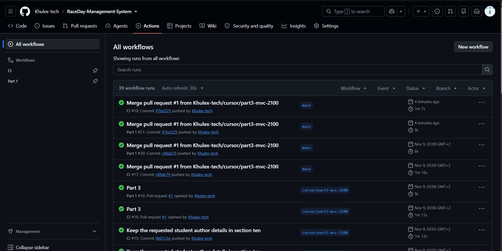

<div align="center">

# RaceDay

### Event management for South African road running, walking and cycling events


**Module:** PROG6212 - Programming 2B &nbsp;|&nbsp; **Portfolio of Evidence:** Parts 1, 2 and 3
**Repository:** RaceDay-Management-System

</div>

---

## Table of Contents

1. [Project Overview](#1-project-overview)
2. [System Roles](#2-system-roles)
3. [Repository Structure](#3-repository-structure)
4. [Part 1 - Planning](#4-part-1---planning)
5. [Part 2 - Web API](#5-part-2---web-api)
6. [Part 3 - MVC Site](#6-part-3---mvc-site)
7. [Azure Blob Storage](#7-azure-blob-storage)
8. [Docker](#8-docker)
9. [Tests and CI](#9-tests-and-ci)
10. [Author](#11-author)

---

## 1. Project Overview

RaceDay is a web-based event management platform for South African road running, walking and cycling events.

| Part | Focus | Deliverables |
| :--: | :---- | :----------- |
| **1** | Plan | ERD, API endpoint plan, SQL script |
| **2** | Back end | ASP.NET Core Web API (40 endpoints), EF Core, Swagger, 41 unit tests, CI |
| **3** | Front end | ASP.NET Core MVC site that calls the API, Azure Blob Storage for images, Docker |

### Part 2 highlights

- **Web API (`RaceDay.API`)**: C# project with an EF Core Code-First context (`RaceDayDbContext`) implementing all 40 endpoints from `docs/API_EndpointPlan.md`.
- **Authentication and roles**: server-side sessions (`ISession`), PBKDF2 password hashing, strict Organiser vs Participant enforcement.
- **Swagger / OpenAPI**: XML documentation comments and annotated HTTP status codes.
- **Unit tests (`RaceDay.Tests`)**: 41 xUnit tests covering authentication, role rejection, trusted Organiser registration, event CRUD, categories, enrolments, results and API health.
- **CI/CD**: GitHub Actions restores, builds and tests on every push.

---

## 2. System Roles

Both roles live in one `Users` table, distinguished by a `Role` column (`Organiser` or `Participant`). The session stores `UserId` and `Role`.

| Role | Capabilities |
| :--- | :----------- |
| **Organiser** | Registers through the trusted invite-code endpoint and logs in. Creates, edits and deletes **their own** events (name, description, date, location, distance, type). Defines categories per event (name, description, entry fee, age range). Views enrolments, confirms or cancels them, and captures finish times and positions. Uploads an event banner. |
| **Participant** | Registers and logs in. Browses events and categories. Enters an event by choosing a category. Views, updates or withdraws their **own** enrolments before race day. Views personal race history. Updates their profile and uploads a profile picture. |

---

## 3. Repository Structure

```text
.
├── .github/workflows/
│   ├── ci.yml                     Build, tests, SQL Server, Azurite, Docker images
│   └── part1.yml                  Part 1 static check workflow
├── docs/
│   ├── RACEDAYERD.png             Section A - ERD
│   ├── API_EndpointPlan.md        Section B - endpoint plan
│   ├── RaceDay_DatabaseScript.sql Section C - schema and seed data
│   ├── SUCCESSFUL-CI.png          Part 1 CI screenshot
│   └── CI.png                     Part 3 CI screenshot
├── RaceDay.API/                   ASP.NET Core Web API
│   ├── Controllers/               Auth, Users, Events, Categories, Enrolments, Results, Support
│   ├── Data/                      DbContext and data seeder
│   ├── Dtos/                      Request / response objects
│   ├── Helpers/                   PBKDF2 hashing, image uploads, role constants
│   ├── Models/                    EF Core entities
│   └── Program.cs                 Middleware, session and Swagger setup
├── RaceDay.Web/                   ASP.NET Core MVC site (calls the API only)
├── RaceDay.Tests/                 API unit tests (controllers, blob URL, race-prep)
├── RaceDay.Web.Tests/             MVC session and navigation tests
├── RaceDay.Integration/           SQL Server and Azurite flow test
├── Dockerfile                     MVC image
├── docker-compose.yml             SQL Server, Azurite, API and MVC
├── RaceDay.sln
├── LICENSE
└── README.md
```

---

## 4. Part 1 - Planning

### Section A - Entity Relationship Diagram


| Entity | Purpose | Key attributes |
| :----- | :------ | :------------- |
| `Users` | Organisers and Participants | PK `UserId`; `Email` UNIQUE; `Role`; `PasswordHash`; optional `PhoneNumber`, `ProfilePictureUrl` |
| `EventTypes` | Run / Walk / Cycle | PK `EventTypeId`; `Name` UNIQUE |
| `Events` | Events owned by an Organiser | PK `EventId`; FK `OrganiserId`; FK `EventTypeId` |
| `Categories` | Entry options for an event | PK `CategoryId`; FK `EventId`; `EntryFee`, `MinAge`, `MaxAge` |
| `Enrolments` | Participant enters an event in a category | PK `EnrolmentId`; FKs `ParticipantId`, `EventId`, `CategoryId`; `EnrolmentStatus` |
| `Results` | Optional result for one enrolment | PK `ResultId`; FK `EnrolmentId` UNIQUE (enforces 1:1) |

| Relationship | Cardinality | Notes |
| :----------- | :---------- | :---- |
| `Users` (Organiser) to `Events` | One-to-many | One Organiser organises many events |
| `EventTypes` to `Events` | One-to-many | One type has many events |
| `Events` to `Categories` | One-to-many | One event has many categories |
| `Users` (Participant) and `Events` | Many-to-many via `Enrolments` | Resolved by the junction entity |
| `Categories` to `Enrolments` | One-to-many | One category is chosen by many enrolments |
| `Enrolments` to `Results` | One-to-one (optional) | An enrolment may have one result |

**Design notes**

1. **Many-to-many via `Enrolments`**: participants and events cannot link directly, so `Enrolments` also stores `CategoryId` and `EnrolmentStatus`.
2. **`Results` hangs off `Enrolments`**: a result cannot exist without an enrolment, and `UNIQUE(EnrolmentId)` allows at most one per enrolment.

### Section B - API Endpoint Plan

Full plan: [`docs/API_EndpointPlan.md`](docs/API_EndpointPlan.md). It was written before any API code and is the contract Part 2 follows.

| Resource group | Examples |
| :------------- | :------- |
| Authentication | `POST /api/auth/register`, `POST /api/auth/login` |
| User Profile | `GET/PUT /api/users/profile`, password change, profile picture |
| Events | List, detail, create, update, delete, banner upload, event types |
| Categories | Nested under events, plus category CRUD |
| Event Enrolments | Enter event, my enrolments, status/category updates, withdraw |
| Results | Capture, update, delete, event results, my results |

Role values are **None** (public), **Any** (logged in), **Organiser** or **Participant**. All routes start with `/api/`.

### Section C - SQL Database Script

Script: [`docs/RaceDay_DatabaseScript.sql`](docs/RaceDay_DatabaseScript.sql). It drops and recreates `RaceDayDb`, so it runs cleanly on any SQL Server instance.

| Seed item | Count | Detail |
| :-------- | :---: | :----- |
| Organisers | 2 | Thabo Mokoena, Ayesha Patel |
| Participants | 4 | Sipho, Lerato, Johan, Nomvula |
| Events | 3 | Soweto Marathon (Run), Cape Town Cycle Tour (Cycle), Durban Beachfront Charity Walk (Walk) |
| Categories | 10 | Across all three events |
| Enrolments | 8 | Pending, Confirmed and Cancelled |
| Results | 3 | Finish times and positions |

Run it in SSMS (open the file, connect, press F5) or from the command line:

```bash
sqlcmd -S "(localdb)\MSSQLLocalDB" -i "docs/RaceDay_DatabaseScript.sql"
```

### ERD and SQL alignment

There are **no deliberate differences** between the ERD and the script: same six entities, attributes, data types, primary and foreign keys, and cardinality (including the optional 1:1 between `Enrolments` and `Results` through `UNIQUE EnrolmentId`).

### Part 1 CI

`part1.yml` runs on pushes to `main`/`master` and on pull requests. It performs static checks only and does not start SQL Server. It verifies that:

- `docs/` and `.github/workflows/` exist, along with the README, ERD, endpoint plan and SQL script;
- the ERD is a non-empty PNG;
- the endpoint plan has the six required columns and covers all resource groups;
- the SQL script has `CREATE TABLE` for all six entities plus `PRIMARY KEY`, `FOREIGN KEY`, `NOT NULL`, `UNIQUE`, `DEFAULT`, `CHECK` and seed `INSERT` statements;
- the README includes the required sections.


---

## 5. Part 2 - Web API

### Prerequisites

- .NET 8.0 SDK
- SQL Server (LocalDB or an SSMS instance with `RaceDayDb`)

### Run it

**1. Set up the database**

```bash
sqlcmd -S "(localdb)\MSSQLLocalDB" -i "docs/RaceDay_DatabaseScript.sql"
```

**2. Start the API**

```bash
dotnet run --project RaceDay.API
```

The API listens on `http://localhost:5043` (`http` profile) or `https://localhost:7043` (`https` profile).

**3. Create a trusted Organiser (optional)**

Public registration creates **Participant** accounts only. To allow Organiser registration, supply the invite code through configuration before starting the API. Never commit it to `appsettings.json`.

```powershell
$env:Authentication__OrganiserInviteCode = "your-private-invite-code"
dotnet run --project RaceDay.API
```

The Organiser registration endpoint reads the code from the `X-Organiser-Invite-Code` header.

**4. Open Swagger UI**

```text
https://localhost:7043/swagger
```

All 40 endpoints are documented with schemas and status codes (`200`, `201`, `400`, `401`, `403`, `404`, `409`).

**5. Run the tests**

```bash
dotnet test
```

---

## 6. Part 3 - MVC Site

`RaceDay.Web` is an ASP.NET Core MVC app. It uses no Entity Framework and never opens SQL Server: every page calls `RaceDay.API` through `RaceDayApiClient`.

**Session handling.** The MVC session stores `UserId`, `Role`, the display name and the API cookie `RaceDay.Session`. The shared `HttpClient` has no cookie jar, so concurrent users cannot pick up each other's API login. Logging out calls the API and then clears the MVC session. Protected pages redirect to `/Account/Login`, Organiser pages reject Participants, and the menu changes with the role.

| Organiser pages | Participant pages |
| :-------------- | :---------------- |
| Dashboard at `/organiser` (event count, enrolment count, upcoming dates) | Home with search, type and date filters |
| Create, edit and delete events | Event detail with route options, current weather and category entry |
| Categories, enrolments and results per event | My Events with status colours, category change and withdrawal |
| Banner upload on the edit page | My Results with finish time and recorded place |
| | Profile, including picture upload |

> **Note on places.** A result such as `47th recorded. 3 results on file.` means the participant's recorded place is 47th, and 3 is the number of results saved. It is **not** the size of the field.

### Seeded logins

All seeded accounts use the password `RaceDay@2026`. The SQL script stores the same PBKDF2 hashes as the EF Core seed.

| Email | Role |
| :---- | :--- |
| `thabo.mokoena@raceday.co.za` | Organiser |
| `ayesha.patel@raceday.co.za` | Organiser |
| `sipho.ndlovu@gmail.com` | Participant |

Public registration creates a Participant. Organiser registration asks for the invite code and sends it in the `X-Organiser-Invite-Code` header. Set the code on the API with `Authentication__OrganiserInviteCode`; never put a live code in `appsettings.json`. The compose file uses `raceday-organiser` for the local demo only.

### Run locally

1. **Database.** Start SQL Server and create `RaceDayDb`: run `docs/RaceDay_DatabaseScript.sql`, or set `Database__ApplyMigrations=true` so EF Core applies `RaceDay.API/Migrations` and the seed data.
2. **Blob storage (for image uploads).**
   ```bash
   npx azurite --silent --location ./azurite --blobPort 10000
   ```
3. **API.**
   ```bash
   dotnet run --project RaceDay.API --launch-profile http
   ```
4. **Website.**
   ```bash
   dotnet run --project RaceDay.Web --launch-profile http
   ```
5. Open **http://localhost:5080**

The API development settings point at the public Azurite emulator account (`devstoreaccount1` on `127.0.0.1:10000`). Its key is the emulator key published by Microsoft and is not a live Azure credential.

### Weather and route

`GET /api/events/{id}/race-prep` builds a route summary from the event location, distance, type and categories. Weather is the current Open-Meteo reading for a known South African start, or a geocoded place when the town is not in the local list. If the forecast cannot be loaded, the event page still opens and reports the weather as unavailable.

---

## 7. Azure Blob Storage

Banners and profile pictures travel from the browser to MVC, then MVC posts the file to the API.

- The API uses `Azure.Storage.Blobs`, keeps the container **private**, and saves the blob URL on the event or user.
- Pages never use the blob URL as an image address. The API streams the file with the storage account key, and MVC serves it at `/Events/Banner/{id}` or `/Profile/Picture`.
- If the file is missing, the page shows a local event-type image or initials instead of a broken image.
- Image reads use only the configured container and never create containers or change access settings.
- Profile image responses are not cached.
- The response content type comes from the allowed filename extension, not from the client-supplied value.

**Local check:** start Azurite, upload a JPG or PNG, and confirm the blob URL is stored and the picture loads through the API.

**Live Azure.** No storage account was provided or created for this repository. To use a real account, set these outside source control:

| Setting | Value |
| :------ | :---- |
| `AzureBlob__ConnectionString` | Storage account connection string |
| `AzureBlob__ContainerName` | `raceday-images` (the name the code uses) |

Keep the container private, and never paste the connection string into chat or `appsettings.json`. A passing Azurite test does not mean a live Azure account was used.

---

## 8. Docker

```bash
docker compose up --build
```

| Service | URL / Port |
| :------ | :--------- |
| MVC site | http://localhost:8080 |
| API | http://localhost:8081 |
| Swagger | http://localhost:8081/swagger (Development only) |
| SQL Server | port `1433`, compose-only password `RaceDay_Dev_2026!` |
| Azurite blob storage | port `10000` |

The images can also be built individually:

```bash
docker build -f Dockerfile .
docker build -f RaceDay.API/Dockerfile .
```

---

## 9. Tests and CI

```bash
dotnet test
```

This builds the API, the MVC site, the unit tests and the MVC navigation tests.

`RaceDay.Integration` talks to SQL Server and Azurite only when both connection variables are set. Add `RACEDAY_REQUIRE_SQL=true` to prevent it from being skipped.

The SQL/Blob regression checks:

- compare uploaded bytes with the API and MVC image responses;
- confirm anonymous blob reads fail;
- keep profile pictures isolated between users;
- keep the sample 47th place separate from the three saved results, so the row count is never treated as the field size.

Without the connection variables the test is reported as **skipped**, not passed.

GitHub Actions (`.github/workflows/ci.yml`) starts SQL Server 2022 and Azurite, sets those variables, runs `dotnet test`, and builds both Dockerfiles. The screenshot below is the Part 3 run on `cursor/part3-mvc-2100`, after the push that added the MVC site, SQL Server, Azurite and the Docker image build.



---

## 10. Author

**Thapelo Mkhari** (Khulex-tech)
PROG6212 - Programming 2B &nbsp;|&nbsp; Part 3 of 3: MVC, Blob Storage and Docker
